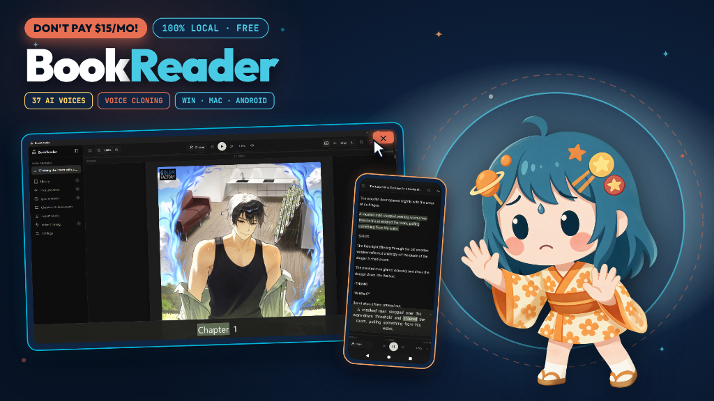

# BookReader

A self-contained cross-platform (**Windows**, **macOS**, & **Android**) text-to-speech reader built with **Rust** and **Tauri v2**, featuring full **7-language UI localization** (**English, Français, Deutsch, Español, Português, Italiano, Nederlands**) and local offline neural TTS powered by **Gradium Phonon 31M** (`gradium/phonon-31m-en`, 37 English voices) and **Kyutai Pocket TTS** (`kyutai/pocket-tts-without-voice-cloning`, 27 voices each across French, German, Spanish, Portuguese, Italian, and Dutch), with optional local **Qwen3-TTS** voice cloning on desktop.

No Python runtime, account, or cloud TTS API is required — models and voices download locally into a portable `BookReader_Data/` folder right next to `BookReader.exe` (Windows) or `BookReader.app` (macOS), or privately inside Android app storage.

**[Download Windows (`BookReader.exe`)](https://github.com/revisionhiep-create/BookReader/releases/latest/download/BookReader.exe)** · **[Download macOS Apple Silicon (`.dmg`)](https://github.com/revisionhiep-create/BookReader/releases/latest/download/BookReader-macos-arm64-portable.dmg)** · **[Download macOS Intel (`.dmg`)](https://github.com/revisionhiep-create/BookReader/releases/latest/download/BookReader-macos-x64-portable.dmg)** · **[Download Android (`.apk`)](https://github.com/revisionhiep-create/BookReader/releases/latest/download/BookReader-android-arm64.apk)** · [View Releases](https://github.com/revisionhiep-create/BookReader/releases/latest) · **[Watch Demo](https://www.youtube.com/watch?v=hOEhrb4LHVg)**

---

## Demo Video

Watch the demo on YouTube: **https://www.youtube.com/watch?v=hOEhrb4LHVg**

---

## Platform Folders

Platform-specific configs, build/test scripts, docs, and binaries are separated into dedicated folders while sharing the unified frontend (`src/`) and Rust backend (`src-tauri/`):

- **`windows/`** — Windows build script (`windows/build.ps1`), Tauri overlay config, standalone `windows/BookReader.exe`, and [Windows Quick Start (`windows/README.md`)](windows/README.md)
- **`macos/`** — macOS portable `.dmg` packager (`macos/build_portable_dmg.sh`), macOS feature verification suite (`macos/test_macos_features.sh`), Tauri overlay config, and [macOS Quick Start (`macos/README.md`)](macos/README.md)
- **`android/`** — Adaptive Android UI (`android/ui/`), multi-device browser preview lab (`npm run preview:android`), Kotlin `MediaSession` service, emulator launcher (`android/run_in_emulator.ps1`), APK build script, and [Android Guide (`android/README.md`)](android/README.md)

---

## Quick Start

### Windows (`BookReader.exe`)
See [windows/README.md](windows/README.md) for full details.
- Put `BookReader.exe` inside its own dedicated folder (e.g., `C:\BookReader\BookReader.exe`).
- On first launch, Windows SmartScreen may show **"Windows protected your PC"** — click **More info** → **Run anyway**.

### macOS Portable (`BookReader.app` via `.dmg`)
See [macos/README.md](macos/README.md) for full details.
- Open the `.dmg` for your Mac (**Apple Silicon `arm64`** or **Intel `x64`**) and drag `BookReader.app` into its own writable folder (e.g., `~/BookReader/`).
- On first launch (unsigned build), **Right-click** `BookReader.app` → **Open** → **Open** (or run `xattr -cr /path/to/BookReader.app`).
- Portable `BookReader_Data/` is created beside `BookReader.app` (falling back automatically to `~/Library/Application Support/Bookreader/BookReader_Data/` if launched from `/Applications` or a read-only disk image).

### Android (`BookReader-android-arm64.apk`)
See [android/README.md](android/README.md) for full Android details, tablet/foldable support, and preview/emulator tools.
1. On your Android phone or tablet (Android 8.0+), download **[BookReader-android-arm64.apk](https://github.com/revisionhiep-create/BookReader/releases/latest/download/BookReader-android-arm64.apk)**.
2. Open the downloaded `.apk` from your browser downloads or **Files** app. If prompted, allow **"Install unknown apps"** for that browser/file manager (Developer Mode / USB debugging is **not** required — `com.bookreader.android` is signed and registered in Android Developer Console).
3. Launch **BookReader** and allow **Notifications** when prompted so background/lock-screen playback controls appear.
4. Choose your preferred language (**English** with Phonon 31M ~65 MB, or **French / German / Spanish / Portuguese / Italian / Dutch** with Kyutai Pocket TTS ~209 MB) and tap **Download**, then tap **Import Book** to open a **PDF**, **EPUB**, **DOCX**, or **TXT** file.
*(Note: Voice Cloning is intentionally excluded on Android to keep mobile size and memory low; all 7 offline TTS languages, full 7-language UI, swipeable bottom sheets, adjustable captions, background narration, and WAV/MP3 export are included.)*

### First-Time Setup & Reading
1. **First-Time Voice Engine Setup**: Select your language (auto-detected from your system locale, changeable anytime in **Settings**) and click **Download** to install Phonon 31M (~65 MB for English) or Kyutai Pocket TTS (~209 MB for FR/DE/ES/PT/IT/NL) into `BookReader_Data/models/`.
2. **Open a Book & Listen**: Click **Import Book** (or open **Library**) and pick a **PDF**, **EPUB**, **DOCX**, or **TXT** file. Click any sentence to jump, or press `Space` to Play/Pause.
3. **Switch Languages, Voices, or Clone a Custom Voice**: Download or switch between any of the 7 TTS languages in **Settings → Language & Voice Models**, browse language-filtered voices in the **Voice Picker** (with native flagship speakers pinned first), or open **Voice Cloning** (`0.6B-Base` ~2.5 GB or `1.7B-Base` ~4.5 GB) with a 3–30s audio clip (uses NVIDIA CUDA on Windows if available, Apple Metal GPU on Apple Silicon, or CPU fallback).
4. **Controls**: Toggle **Closed Captions (CC)** (`A-`/`21px`/`A+`), zoom with `Ctrl`/`⌘` + `+/-` or `Ctrl`/`⌘` + Wheel, toggle **Dark Page** on PDFs, and drag **Header & Footer Ignore Margins** on PDFs.

---

## Supported Languages & Offline Models

All 7 languages are **ungated** on Hugging Face (no account or API key required) and include a fully localized desktop + Android interface:

| Code | Language | TTS Engine | Download Size | Voices | Flagship / Default Voice |
| --- | --- | --- | --- | --- | --- |
| `en` | English | Gradium **Phonon 31M** | ~65 MB | 37 | **Easton** |
| `fr` | Français | **Kyutai Pocket TTS** | ~209 MB | 27 | **Estelle** |
| `de` | Deutsch | **Kyutai Pocket TTS** | ~209 MB | 27 | **Juergen** |
| `es` | Español | **Kyutai Pocket TTS** | ~209 MB | 27 | **Lola** |
| `pt` | Português | **Kyutai Pocket TTS** | ~209 MB | 27 | **Rafael** |
| `it` | Italiano | **Kyutai Pocket TTS** | ~209 MB | 27 | **Giovanni** |
| `nl` | Nederlands | **Kyutai Pocket TTS** | ~209 MB | 27 | **Daan** |

---

## Features

- **Document Support with Inline Images & PDF Reflow Text**: Read **PDF**, **EPUB**, **DOCX** (Word), and **TXT** files while keeping embedded document images intact, or toggle **Reflow Text** on PDFs for clean prose wrapping and typography control.
- **7 Offline Languages (Phonon 31M + Kyutai Pocket TTS) & Voice Picker Model Detection**:
  - **English (`en`)**: 37 Gradium Phonon 31M voices (US, UK, and Character voices).
  - **French (`fr`), German (`de`), Spanish (`es`), Portuguese (`pt`), Italian (`it`), & Dutch (`nl`)**: 27 pure-Rust Kyutai Pocket TTS speakers per language with native flagship speakers (**Estelle**, **Juergen**, **Lola**, **Rafael**, **Giovanni**, **Daan**) pinned first.
  - **Voice Picker Model Detection**: Automatically detects the active TTS model/language, lets you switch downloaded language models inline, and strictly displays only voices for the active model/language (plus desktop **Cloned** voices).
  - **Full 7-Language Interface**: Live-switchable UI across English, Français, Deutsch, Español, Português, Italiano, and Nederlands without restarting.
  - **Custom Voice Cloning & Auto-Unload Safeguard (Desktop)**: Local **Qwen3-TTS 0.6B-Base** (Fast, ~2.5 GB) / **1.7B-Base** (Best Quality, ~4.5 GB) voice cloning (3–30s reference clips, 5–15s recommended, with optional transcript for high-fidelity ICL mode or instant X-Vector mode) stored under the **Cloned** category. Switching away from a cloned voice or switching TTS languages automatically unloads Qwen3-TTS from VRAM/RAM (once any active cloned-voice export finishes) and unloads inactive language models.
- **Live Highlighting & Closed Captions (CC)**:
  - Highlights the active sentence accurately on the PDF canvas overlay (without cross-page bleed) or rich text view and scrolls smoothly along the top of the viewport.
  - Toggleable **Closed Captions** bar shows smooth 60–120 FPS latency-compensated word-by-word highlighting with adjustable caption font size (`A-` / `21px` / `A+` in the top toolbar and a slider in **Settings**).
- **Page Zoom & Dark Mode**:
  - Top-toolbar **Page Zoom** controls (`-` / `100%` / `+`), keyboard shortcuts, and `Ctrl+Wheel` across PDF, EPUB, DOCX, and TXT.
  - Toggleable **Dark / Light** theme plus a **Dark Page** toggle in the top toolbar to invert white PDF pages when reading in dark mode.
- **Smart Auto-Scroll ("Back to reading")**:
  - Scroll freely anywhere in a book to re-read or skim ahead while narration continues.
  - Auto-scroll automatically pauses when manual scrolling is detected and displays a **Back to reading** button anchored cleanly above the Closed Captions bar.
- **Draggable Header & Footer Ignore Margins (PDF)**:
  - Drag top and bottom margin lines directly on PDF pages to preview blurred ignore regions so page numbers and running headers are excluded from narration.
- **Pronunciation & Ignore Word Rules + Symbol Sanitization**:
  - Dedicated **Pronunciation** and **Ignore Words** rule editors supporting regex patterns, literal matching, **Match Case**, and **Ignore Word Boundary** toggles, plus instant audio preview.
  - Built-in sanitization cleans expressive repeated punctuation (`!!!!`, `?!`, `...!`, stray `~`), foreign symbol emotes, stray brackets, and optional citation tags before speech synthesis so neural TTS stays natural on light novels and webnovels.
- **Natural Pauses & Pitch-Preserving Speed**:
  - Per-punctuation pause configuration for periods (`.`), commas (`,`), semicolons (`;`), and paragraph breaks.
  - Smooth `0.50x`–`3.00x` WSOLA time-stretching preserves natural pitch, paired with system media key integration and Windows wake lock during playback/export.
- **Search, TOC, Bookmarks, Warmup Banner & Audio Export**:
  - Full-document search (`Ctrl+F`), chapter Table of Contents, automatic position saving with instant bookmark jump, a startup/model-warmup & PDF indexing status banner, chapter/minute sleep timers, and multi-minute offline **WAV / MP3** export with live progress bars.
- **Persistent Window Placement & Multi-Monitor Safeguards**:
  - Remembers your window position, size, and maximized state across launches, and automatically relocates onto active screen real estate if a previously used monitor is disconnected.

---

## Keyboard Shortcuts

| Shortcut | Action |
| --- | --- |
| `Space` | Play / Pause narration |
| `Left Arrow` / `Right Arrow` | Previous / Next sentence |
| `Ctrl + F` / `⌘ + F` | Open document search |
| `Ctrl + =` / `⌘ + =` | Zoom page in |
| `Ctrl + -` / `⌘ + -` | Zoom page out |
| `Ctrl + 0` / `⌘ + 0` | Reset page zoom to `100%` |
| `Ctrl + Wheel` / `⌘ + Wheel` | Smooth zoom over reader viewport |

*(Shortcuts do not hijack typing when an input field or modal dialog is focused.)*

---

## Data & Settings Storage

BookReader automatically initializes two folders:

- **Portable Assets** (`BookReader_Data/` next to `BookReader.exe` or `BookReader.app` in release builds, or in the workspace root during dev):
  - `BookReader_Data/models/phonon-31m-en/` — downloaded Phonon 31M English weights and tokenizer files
  - `BookReader_Data/models/pocket-tts/<language>/` — downloaded Kyutai Pocket TTS weights and tokenizer files (`french`, `german`, `spanish`, `portuguese`, `italian`, `dutch`)
  - `BookReader_Data/models/qwen3-tts-0.6b-base/` — downloaded Qwen3-TTS 0.6B-Base weights and 12Hz speech tokenizer (Fast, ~2.5 GB)
  - `BookReader_Data/models/qwen3-tts-1.7b-base/` — downloaded Qwen3-TTS 1.7B-Base weights and 12Hz speech tokenizer (Best Quality, ~4.5 GB)
  - `BookReader_Data/voices/` — downloaded Phonon voice files, `pocket/<lang>/` Pocket speaker embeddings, and `cloned/` custom voice prompts
  - `BookReader_Data/books/` — imported copies of your books and cached assets
- **User Preferences** (`%APPDATA%\Bookreader\` on Windows, `~/Library/Application Support/Bookreader/` on macOS, private app storage on Android):
  - Saved immediately on every setting change: UI language (`ui_language`), active TTS language (`tts_language`), theme, voice, speed, typography, zoom, caption font size, pause durations, dark PDF page state, PDF reflow state, pronunciation rules, ignore rules, library reading progress/bookmarks, and saved desktop window geometry (`window_state.json`).

---

## Building from Source

See [windows/README.md](windows/README.md) for Windows build instructions, [macos/README.md](macos/README.md) for macOS `.app` & `.dmg` instructions, and [android/README.md](android/README.md) for Android APK build & emulator instructions.

---

## Attribution & Stack

- **English TTS Engine**: [Gradium Phonon 31M (`gradium/phonon-31m-en`)](https://huggingface.co/gradium/phonon-31m-en) via [`ptts`](https://crates.io/crates/ptts)
- **Multilingual TTS Engine**: [Kyutai Pocket TTS (`kyutai/pocket-tts-without-voice-cloning`)](https://huggingface.co/kyutai/pocket-tts-without-voice-cloning) (FR/DE/ES/PT/IT/NL) via [`ptts`](https://crates.io/crates/ptts) & [`xn`](https://crates.io/crates/xn)
- **Voice Cloning Engine**: [Qwen3-TTS](https://huggingface.co/Qwen) (`0.6B-Base` / `1.7B-Base`) via [`qwen_tts`](https://crates.io/crates/qwen_tts) & [`candle-core`](https://crates.io/crates/candle-core)
- **Desktop Framework**: [Tauri v2](https://v2.tauri.app/) (Rust + Edge WebView2)
- **PDF Rendering**: [PDF.js (`pdfjs-dist`)](https://mozilla.github.io/pdf.js/)
- **Audio & Media**: `cpal`, `hound`, `mp3lame-encoder`, `souvlaki`
